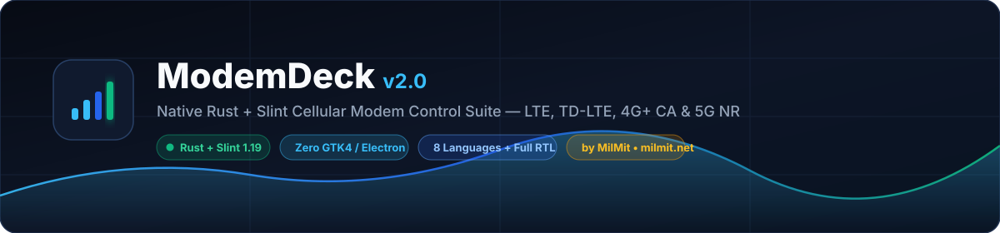

<p align="center">
  
</p>

<p align="center">
  
  
  
  
  
</p>

<p align="center">
  <strong>Native, lightweight cellular modem management suite for Linux — built with Rust, Slint, ModemManager, NetworkManager &amp; SQLite.</strong><br>
  Zero Electron, zero Chromium, zero GTK4/GIO UI dependencies.
</p>

---

## ✨ What's New in v2.0.0 (Rust + Slint Overhaul)

- **🎨 Centralized Slint Design System**: Built from scratch with [tokens.slint](ui/tokens.slint), [theme.slint](ui/theme.slint), [components.slint](ui/components.slint), [tr.slint](ui/tr.slint), and [main.slint](ui/main.slint) — supporting **Dark**, **Light**, and **High-Contrast** themes, **4 font-scale presets** (`Small`, `Default`, `Large`, `Extra Large`), **Basic / Advanced / Expert** UI modes, and **Reduced Motion**.
- **🌍 8 Languages + True RTL Layout**: Live, zero-restart switching across **English, فارسی (RTL), العربية (RTL), Türkçe, Deutsch, Français, Español, Русский** with 100% validated key coverage ([catalog.rs](src/i18n/catalog.rs), [validation.rs](src/i18n/validation.rs)). In RTL locales, the sidebar, navigation indicators, card headers, and controls mirror cleanly while keeping technical values (`RSRP: -87 dBm`, `B1+B3+B7`, `432-35`, `AT+CSQ`) readable.
- **⚡ Pure-Rust Async D-Bus & SQLite**: Migrated off `gtk4` / `gio` / `glib` to `zbus 6.5` + `tokio` ([src/modem/manager.rs](src/modem/manager.rs), [src/core/power.rs](src/core/power.rs)) and `rusqlite 0.43` WAL storage ([src/storage/sqlite_db.rs](src/storage/sqlite_db.rs)).
- **📡 Live 3-Second Telemetry & Active Band Inspection**: Non-blocking background poller updates `Signal %`, `RSRP / RSRQ / SINR / RSSI` quality ratings, live RX/TX, daily/monthly usage, and the 24h SVG telemetry chart automatically, with 1-click **Read Active Band** vendor telemetry (`Serving Band`, `EARFCN`, `PCI`, `CA`).
- **🔬 Full-Band Analyzer with Live Speed Test & 1-Click Apply**: Tests **all** supported modem bands (`4G/5G` first, then `3G/2G`) with `15s`, `45s`, or `5m` durations, live stage progress, per-band **Download / Ping / Score** table, and a 1-click **Apply** button on every tested row.
- **🛡️ Hotspot Uplink Selector, VPN Leak Guard & Fail-Closed**: Visual path diagram (`[Clients] ──▶ [AP] ──▶ [Uplink] ──▶ [Internet]`), uplink selection (`Auto`, `Cellular`, `Ethernet`, `Wi-Fi`, `VPN`), Full vs. Split-Tunnel detection, DNS/IPv6 leak warnings, honest `Verified / Unverified / Backend Required` badges, and Linux `nftables` **Fail-Closed** kill-switch ([src/hotspot/uplink.rs](src/hotspot/uplink.rs)).
- **🖥️ Native System Tray, Notifications & GNOME Extension**: StatusNotifierItem tray via `ksni` ([src/tray/mod.rs](src/tray/mod.rs)) with live 22×22 ARGB32 signal-bar icon, Close-to-Tray, Single-Instance Unix socket IPC, Freedesktop D-Bus notifications ([src/notifications/mod.rs](src/notifications/mod.rs)), and localized GNOME top-bar extension (`modemdeck@milmit.net`).
- **🐛 Live Debug Console & Busy States**: Built-in `Debug` toggle console recording timestamped UI clicks and backend errors with **Copy Log** & **Clear**, plus a **Please Wait** banner that locks long-running actions against accidental double-clicks.

---

## 🧩 Feature Matrix

| Area | Capabilities |
|---|---|
| **Overview & Radio** | Multi-modem selector, live 3s RF polling (`RSRP`, `RSRQ`, `SINR`, `RSSI` + quality grades), 24h SVG chart with Min/Avg/Max, `EARFCN`/`PCI`/`Cell ID`, `Read Active Band` vendor telemetry |
| **Band Manager & Profiles** | Categorized bands (`4G LTE FDD`, `4G LTE TDD`, `5G NR`, `3G UMTS`), `Select All`/`Deselect All`, **45-second crash-safe rollback**, **Saved Band Profiles**, **Persistent Band Lock** |
| **Band Analyzer & Speed Test** | Full-band RF + interface-bound HTTP speed & ping scan (`15s` / `45s` / `5m`), live stage & RF readout, sortable results table with 1-click **Apply** |
| **Operators & Auto APN** | **988 operators across 152 countries** ([src/operators/mod.rs](src/operators/mod.rs)), MVNO disambiguation (`SPN`/`GID1`), live search by name/country/`MCC-MNC`, 1-click Recommended APN |
| **SIM, eSIM & APN** | SIM PIN unlock, Slot 1/2 capability-gated switching, eSIM/eUICC detection & profile listing, NetworkManager APN **Create / Activate / Delete** |
| **SMS, Voice & USSD** | SMS inbox & compose, USSD dialer & session replies, Voice Call dial / hangup / list |
| **GPS & Cell Analyzer** | Opt-in GNSS enable/disable/fix, GPX & CSV export, serving cell summary |
| **Modem Doctor & NetDiag** | Localized automated health audit (`ModemManager`, `NetworkManager`, RFKill, SIM, FCC Lock, Routing, DNS), safe auto-fix, HTML Health Card & privacy-safe diagnostics export, Domestic vs. International probes |
| **Hardware & Firmware** | Structured KPIs (`Host`, `Driver`, `Hardware Match`, `Bus Link`, `Power Mgmt`, `Thermal`, `Firmware`, `fwupd`, `LVFS`), settings backup & hardware report export |
| **Hotspot & Failover** | Uplink selector, VPN tunnel & DNS/IPv6 leak guard, `nftables` Fail-Closed kill-switch, capability-gated Wi-Fi `2.4/5 GHz` & `WPA2/WPA3`, connected clients list, Route Priority policy |
| **Pro Tools & Safe AT** | Capability-gated Network Mode (`Auto`, `4G Only`, `5G` disabled on LTE-only modems), 3GPP Network Scanner with per-row manual **Register**, Antenna Positioning Assistant, Safe Read-Only/Guarded AT Terminal |

---

## 🌐 Cross-Platform Architecture Status

| Capability | Linux | Windows | macOS |
|---|---|---|---|
| **Modem Control & RF** | ✅ ModemManager + `zbus` + Vendor AT/MBIM | 🚧 Planned (`WinRT` / `MBIM`) | 🚧 Planned (`CoreTelephony` / Serial) |
| **Slint UI & Design System** | ✅ Slint 1.19.1 (`winit` + HW/SW render) | ✅ Shared Slint UI | ✅ Shared Slint UI |
| **Hotspot & Uplink** | ✅ `NetworkManager` + `iw` + `ip route` | 🚧 Backend Required (`ICS` / `WinRT`) | 🚧 Backend Required (`pf` / `bootpd`) |
| **VPN Fail-Closed** | ✅ `nftables` (`pkexec nft`) | 🚧 Backend Required (`WFP`) | 🚧 Backend Required (`pfctl` anchor) |
| **System Tray** | ✅ `ksni` StatusNotifierItem | ✅ Slint / `tray-icon` ready | ✅ Slint / Menu bar ready |

---

## 🚀 Build, Test & Install (Ubuntu / Linux)

The current stable version is **2.0.0**. Download validated Linux packages from the [GitHub Releases page](https://github.com/MilMit/modemdeck-linux/releases/latest).

### Prerequisites
- Rust toolchain (`rustc >= 1.95`, edition `2024`)
- `ModemManager`, `NetworkManager`, `libdbus-1-dev`, `pkg-config`, `iw`

### Verify & Test
```bash
cargo fmt --all -- --check
cargo check --all-targets
cargo clippy --all-targets --all-features -- -D warnings
cargo test --all-targets
```

### Install for Current User (Desktop Menu + GNOME Extension)
```bash
bash ./scripts/install-user.sh
modemdeck
```

> **Note:** `scripts/install-user.sh` builds the release binary, installs `~/.local/bin/modemdeck`, configures `~/.local/share/applications/net.milmit.ModemDeck.desktop` with the exact binary path, and installs the `modemdeck@milmit.net` GNOME Shell indicator.

### CLI Usage
```bash
modemdeck --version
modemdeck doctor --json
modemdeck operator info --json
modemdeck --minimized
```

---

## 🔒 Privacy & Safety

- **No Personal Identifiers Exported**: Privacy-safe diagnostics omit IMEI, IMSI, ICCID, and phone numbers.
- **Local-Only Storage**: SQLite WAL history (`modemdeck.db`) and JSON settings reside locally under `$XDG_DATA_HOME/modemdeck` and `$XDG_CONFIG_HOME/modemdeck`.
- **45-Second Crash-Safe Rollback**: Band and profile changes arm a detached rollback guard that restores previous bands if unconfirmed or after a crash.

---

<p align="center">
  Developed by <strong>MilMit</strong> · <a href="https://milmit.net">milmit.net</a> · Licensed under <strong>GPL-3.0-or-later</strong>
</p>
